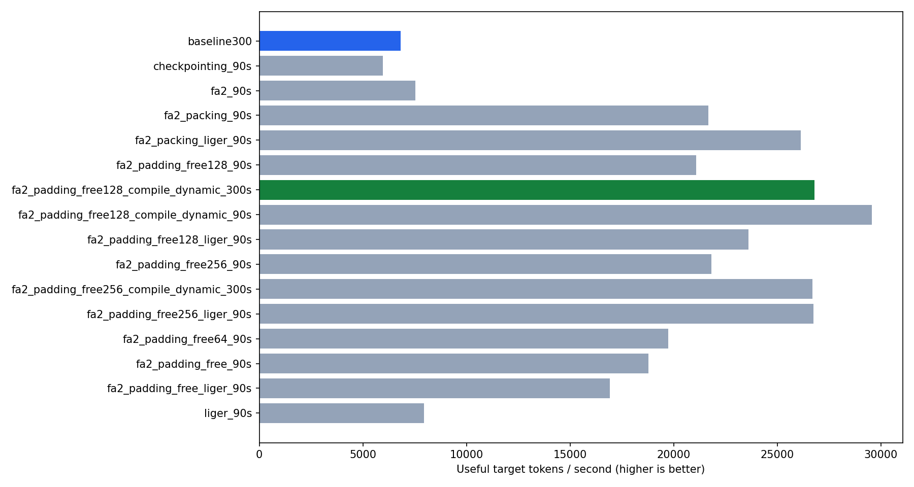
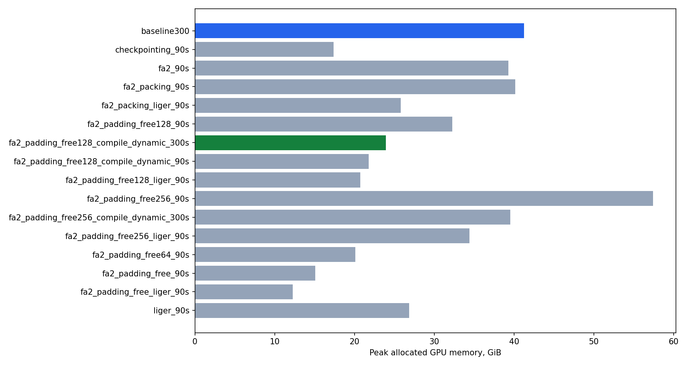
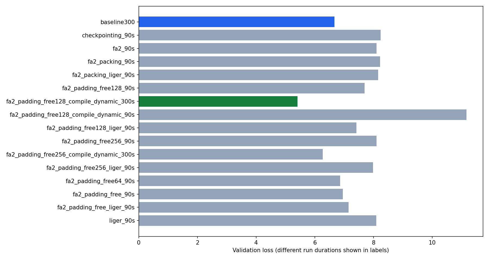
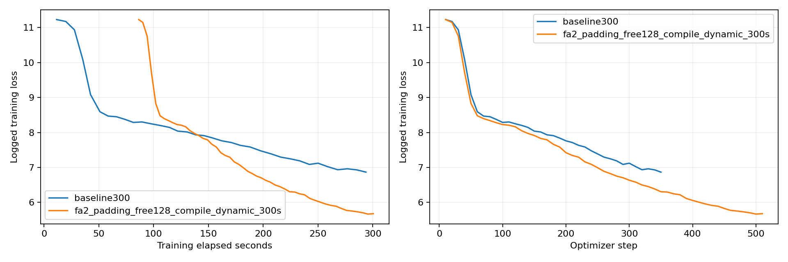

# ДЗ2: ускорение обучения и кольцевые коммуникации

В работе были сравнены способы ускорить обучение Qwen3 на одной A100. Основная цель - обрабатывать больше полезных токенов в секунду, не меняя модель, данные и обязательные параметры обучения. В итоге получилось ускорение **3.92×** относительно бейзлайна.

## Сетап

- GPU: одна NVIDIA A100 80GB PCIe. Все запуски шли последовательно на одной и той же карте.
- Модель: Qwen3, 960 881 664 параметра. Конфиг: `hidden_size=2048`, 12 слоёв, 16 attention heads, 8 KV heads, `intermediate_size=8192`, `head_dim=128`, `use_cache=False`. Каждый эксперимент начинался с нуля, без весов из ДЗ1.
- Данные: Wikipedia `20231101.ru`, первые 50 500 статей, из них первые 500 — validation. По шаблону отбирались до 8 абзацев длиной от 80 символов на статью, оставлялись примеры от 32 токенов и добавлялся EOS. Получилось 244 768 train-абзацев и 2 928 validation-абзацев без пересечения статей. Для eval использовались первые 512 validation-примеров.
- Токенизатор: `ai-forever/rugpt3small_based_on_gpt2`. Максимальная длина — 512 токенов. Ревизии данных и токенизатора закреплены в `train.py`. Исходные данные взяты из кэша ДЗ1, но подготовлены заново по правилам ДЗ2.
- Общие настройки: BF16, TF32, `adamw_torch_fused`, LR `3e-4`, `constant_with_warmup`, warmup 200 шагов, weight decay `0.01`, seed и data_seed `42`, `loss_type=nll`. Эти параметры и подсчёт метрик не менялись.
- Окружение: Python 3.10, PyTorch 2.6.0+cu118, Transformers 4.56.2, TRL 0.23.1, datasets 3.6.0, accelerate 1.6.0, FlashAttention 2.7.3, Liger 0.6.2.

Бейзлайн — SDPA, batch size 32, gradient accumulation 2, остальные оптимизации выключены. Бейзлайн и два финальных варианта обучались по 300 секунд, остальные конфигурации проверялись на 90-секундных запусках.

## Подсчёт метрик

Использовалась метрика `tokens_per_second` из шаблона: считаются только позиции, где `labels != -100`, а первые 10 шагов оптимизатора исключаются из замера скорости. Это не то же самое, что LR warmup на 200 шагов. Пиковая GPU-память измеряется до evaluation; подготовка данных и evaluation не входят во время обучения. Остановка происходит после завершения шага, поэтому фактическое время иногда чуть больше заданного.

Кэш компиляции между запусками не очищался. При этом веса каждый раз инициализировались заново. Короткие compile-тесты стоит воспринимать осторожно: компиляция могла съесть почти весь бюджет. Кроме основной метрики ниже приведена скорость финального запуска с учётом первых шагов.

## Эксперименты

В таблице `bs × GA` — batch size и gradient accumulation, FA2 — FlashAttention2, PF — padding-free, ckpt — activation checkpointing. `dynamic` означает compile с динамическими длинами и расчётом границ последовательностей в CPU-collator. Память указана как peak allocated / reserved.

| Запуск | Время, с | bs × GA | Оптимизации | Полезных ток/с | Память, GiB | Val loss | Шагов |
|---|---:|---|---|---:|---|---:|---:|
| baseline300 | 300.6 | 32 × 2 | SDPA | 6831 | 41.24/43.44 | 6.6664 | 357 |
| batch64_90s | — | 64 × 1 | SDPA | OOM | — | — | — |
| checkpointing_90s | 90.5 | 32 × 2 | SDPA, ckpt | 5953 | 17.39/23.97 | 8.2368 | 92 |
| compile_90s | 105.0 | 32 × 2 | SDPA, compile | — | 26.02/26.32 | 11.2346 | 1 |
| fa2_90s | 90.5 | 32 × 2 | FA2 | 7541 | 39.30/41.60 | 8.0988 | 117 |
| fa2_offloading_90s | 90.4 | 32 × 2 | FA2, offload | — | 14.49/20.51 | 11.2205 | 9 |
| fa2_packing_90s | 91.2 | 32 × 2 | FA2, packing | 21680 | 40.15/76.20 | 8.2260 | 61 |
| fa2_packing_liger_90s | 90.3 | 32 × 2 | FA2, packing, Liger | 26136 | 25.82/33.15 | 8.1609 | 72 |
| fa2_padding_free128_90s | 90.0 | 128 × 1 | FA2, PF | 21090 | 32.26/48.43 | 7.6907 | 165 |
| fa2_padding_free128_compile_dynamic_300s | 300.4 | 128 × 1 | FA2, PF, compile, dynamic | 26788 | 23.92/37.02 | 5.4045 | 510 |
| fa2_padding_free128_compile_dynamic_90s | 90.2 | 128 × 1 | FA2, PF, compile, dynamic | 29565 | 21.76/24.76 | 11.1682 | 14 |
| fa2_padding_free128_liger_90s | 90.4 | 128 × 1 | FA2, PF, Liger | 23616 | 20.74/29.17 | 7.4156 | 184 |
| fa2_padding_free128_liger_compile_dynamic_90s | 102.2 | 128 × 1 | FA2, PF, compile, Liger, dynamic | — | 22.31/24.91 | 11.2331 | 4 |
| fa2_padding_free256_90s | 90.5 | 256 × 1 | FA2, PF | 21828 | 57.42/75.35 | 8.1047 | 86 |
| fa2_padding_free256_compile_dynamic_300s | 300.1 | 256 × 1 | FA2, PF, compile, dynamic | 26702 | 39.53/52.83 | 6.2699 | 255 |
| fa2_padding_free256_compile_dynamic_90s | 90.7 | 256 × 1 | FA2, PF, compile, dynamic | — | 35.57/41.10 | 11.2236 | 7 |
| fa2_padding_free256_liger_90s | 90.4 | 256 × 1 | FA2, PF, Liger | 26741 | 34.40/48.02 | 7.9810 | 104 |
| fa2_padding_free64_90s | 90.3 | 64 × 1 | FA2, PF | 19725 | 20.12/35.53 | 6.8665 | 310 |
| fa2_padding_free64_compile_dynamic_90s | 107.8 | 64 × 1 | FA2, PF, compile, dynamic | — | 13.72/14.19 | 11.2346 | 2 |
| fa2_padding_free_90s | 90.2 | 32 × 2 | FA2, PF | 18786 | 15.11/21.24 | 6.9510 | 295 |
| fa2_padding_free_liger_90s | 90.2 | 32 × 2 | FA2, PF, Liger | 16908 | 12.28/13.97 | 7.1509 | 259 |
| liger_90s | 90.0 | 32 × 2 | SDPA, Liger | 7941 | 26.83/28.47 | 8.0927 | 121 |

Прочерк в скорости означает, что запуск не прошёл первые 10 шагов и измерять основную метрику было не на чем. SDPA с batch 64 не поместился в память. У offloading память снизилась, но за 90 секунд получилось только 9 шагов, поэтому для этого бюджета вариант оказался слишком медленным.

Полные конфиги и `summary.json` 16 успешных измеримых запусков лежат в `results/`. Бейзлайн — в `results/baseline/`.

## Что получилось

Для итогового запуска выбрана конфигурация FA2 + padding-free + `torch.compile` с динамическими длинами, batch 128 и gradient accumulation 1. Checkpointing, packing, Liger и offloading в финальном варианте выключены.

Ускорение относительно 300-секундного бейзлайна:

**S = 26787.83 / 6831.11 = 3.9214×.**

За финальный запуск получились 510 шагов и 5 843 783 полезных токена. Validation loss — **5.4045** против **6.6664** у бейзлайна, peak allocated — **23.92 GiB** против **41.24 GiB**. Если включить первые шаги в замер скорости, получается 19 455 ток/с против 6 762 ток/с. То есть выигрыш есть и с учётом разогрева, но он меньше основного S.

Batch 256 на 300 секундах дал почти ту же скорость: 26 702 ток/с. Разница всего 0.32%, так что без повторных запусков считать batch 128 достоверно быстрее нельзя. Но у него заметно меньше память — 23.92 против 39.53 GiB — и ниже loss: 5.4045 против 6.2699. Поэтому в итоговой конфигурации оставлен batch 128.

## Наблюдения

1. **Самый большой выигрыш дало удаление padding.** Средний train-пример содержит примерно 91 токен, поэтому дополнение до длинного примера в батче создаёт много лишней работы. При одинаковом batch 32 × 2 переход с FA2 на FA2 + PF поднял скорость с 7 541 до 18 786 ток/с, а память снизил с 39.30 до 15.11 GiB.

2. **Checkpointing — скорее способ сэкономить память.** Пик allocated упал с 41.24 до 17.39 GiB, но скорость тоже снизилась: с 6 831 до 5 953 ток/с. Это ожидаемо: часть активаций приходится заново вычислять в backward. Для A100 80GB такая экономия в этом эксперименте не была нужна.

3. **Оптимизации не всегда хорошо складываются.** При batch 32 × 2 добавление Liger к padding-free снизило память до 12.28 GiB, но и скорость упала с 18 786 до 16 908 ток/с. Зато с packing Liger помог: 21 680 → 26 136 ток/с. Поэтому просто включить всё сразу — не лучшая стратегия; сочетания нужно замерять отдельно.

4. **Compile полезен после разогрева, но короткий тест легко вводит в заблуждение.** В PF + compile с batch 128 за 90 секунд было всего 14 шагов, из которых измерялись только 4. Полученные 29 565 ток/с выглядели хорошо, но надёжнее ориентироваться на отдельный 300-секундный запуск: 26 788 ток/с и 500 измеренных шагов. Для переменной длины использовались dynamic shapes, а границы документов заранее рассчитывались в collator, без изменения inputs и labels.

5. **Больше токенов в секунду не обязательно означает меньший loss.** Packing за 90 секунд сделал 61 шаг, а PF с batch 32 × 2 — 295. При фиксированном LR warmup на 200 шагов это разные стадии обучения. У двух 300-секундных финалистов число токенов вообще совпало, но batch 128 сделал 510 обновлений, а batch 256 — 255. Это может объяснять разницу в loss, но отдельный эксперимент для проверки этой причины не проводился. Напрямую сравнивать качество 90- и 300-секундных запусков тоже нельзя.

Измерения сделаны без повторов, поэтому небольшие различия в скорости могут быть шумом. Главный вывод для этого сетапа: сначала стоит убрать лишний padding, а потом подбирать batch и проверять compile. Максимальный batch и максимальное число включённых оптимизаций сами по себе не гарантируют лучший результат.

## Графики









Кривые train loss взяты из логов без сглаживания. Для расчёта итогового ускорения использованы только 300-секундные запуски.

## Кольцевые коммуникации

В `collectives.py` реализованы три операции через обмены с соседями (`isend`/`irecv`):

- `ring_reduce_scatter`: за P−1 обменов суммирует чанки, после чего процесс r получает сумму чанка r.
- `ring_all_gather`: за ещё P−1 обменов собирает все готовые чанки в порядке rank.
- `ring_all_reduce`: последовательно вызывает эти две операции и возвращает сумму, не среднее.

Входные тензоры не меняются. Для одного процесса возвращается копия. Проверки на CPU/Gloo прошли для 1, 2, 3 и 4 процессов и размеров чанка 1, 7, 31: результаты совпадают с PyTorch. Выводы проверок сохранены в `communications.ipynb`.

## Как повторить

В окружении с версиями из сетапа, на одной A100:

```bash
python train.py --output-dir results/new_final_300s
python train.py --config results/baseline/config.json --output-dir results/new_baseline_300s
```

Любой другой сохранённый конфиг можно передать через `--config`. Папка результата должна быть новой. Если подготовленных данных нет в `data/`, скрипт создаст их сам. Проверки коммуникаций запускаются выполнением всех ячеек ноутбука.
