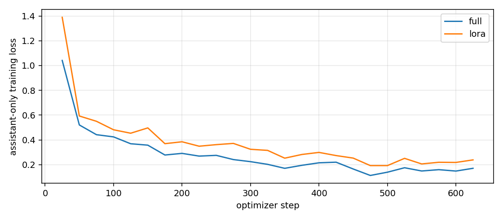

# ДЗ4. Full FT и LoRA

В работе сравнивались полное дообучение и LoRA для `Qwen/Qwen2.5-1.5B-Instruct`. Задача — определить эмоцию короткого английского текста. Получилось что выбор слоев для LoRA здесь повлиял сильнее, чем увеличение rank.

## Данные и обучение

Использован вариант А: готовый датасет [Emotion](https://huggingface.co/datasets/dair-ai/emotion), конфигурация `split`. В ней 16 000 обучающих, 2 000 валидационных и 2 000 тестовых примеров. Он подходит для короткого эксперимента: есть реальные тексты, шесть классов и результат можно проверить вручную.

Для всех запусков взяты одинаковые **10 000 примеров из train и все 2 000 из test**. Обучающая часть перемешана с seed 42, повторы и тексты из test исключены перед отбором. Валидационная часть не использовалась. Это небольшой эксперимент, не обучение на всем доступном корпусе.

Примеры из выбранного train:

| Текст | Метка |
|---|---|
| i am in no way complaining or whining or feeling ungrateful | sadness |
| i had pocket qq and was feeling pretty confident lol | joy |
| while cycling in the country | fear |

Последняя метка не очень понятная по самому тексту. То есть разметка тоже не всегда очевидная, это стоит учитывать при оценке.

Модель получает инструкцию с соответствием `0=sadness, 1=joy, 2=love, 3=anger, 4=fear, 5=surprise` и текст. Ответ — одна цифра. На обучении loss считается только по этой цифре и токену конца ответа, не по инструкции и входному тексту.

Общие настройки:

- Одна A100-SXM4 80GB, GPU 0. Запуски выполнялись по очереди.
- Одна эпоха, 625 шагов, batch size 16, gradient accumulation 1, seed/data_seed 42.
- BF16, SDPA, `adamw_torch_fused`, cosine scheduler, warmup 5%, weight decay 0.01.
- Входной текст ограничен 128 токенами, весь обучающий пример — 256. Генерация жадная, максимум 4 новых токена.
- LR для Full FT — `2e-5`, для всех LoRA — `2e-4`. Это разные LR, поэтому сравниваются выбранные настройки методов, а не только способ обновления весов при одинаковом LR.
- Full FT обновляет все 1 543 714 304 параметра. LoRA замораживает базовые веса и обучает только адаптеры, без квантизации. Каждый запуск начинается с исходной предобученной модели, не с предыдущего эксперимента.

Версии: Python 3.12, PyTorch 2.8.0+cu126, Transformers 4.56.1, PEFT 0.17.1, datasets 3.6.0, accelerate 1.6.0. Ревизии модели и датасета, состав выборок и их хеши сохранены в `outputs/data_manifest.json`, полные конфиги — в `outputs/configs.json`.

## Метрики и основное сравнение

Выбраны две метрики на задаче дообучения:

- **Accuracy** — доля правильных ответов, ее просто интерпретировать.
- **Macro-F1** — средний F1 по шести классам с одинаковым весом. Это важно потому что в test 695 примеров joy, но только 66 surprise. Одной accuracy можно не заметить плохую работу на редких эмоциях.

Обе метрики считаются на всех 2 000 тестовых примерах для каждой модели. Ответ не в формате одной цифры считается ошибкой, такие примеры не выбрасываются. В этих запусках нарушений формата не было.

| Модель | Accuracy, % | Macro-F1, % | Обучаемых параметров | Обучение, с | Пик GPU alloc / reserved, GiB |
|---|---:|---:|---:|---:|---:|
| Исходная | 33.80 | 28.85 | 0 | — | — |
| Full FT | 88.60 | 83.10 | 1 543 714 304 | 94.2 | 19.22 / 29.31 |
| LoRA базовая | 83.60 | 77.54 | 1 089 536 | 72.7 | 11.98 / 23.96 |
| LoRA attention + MLP | 92.25 | 87.65 | 9 232 384 | 105.9 | 13.92 / 25.69 |

Время измерялось вокруг `trainer.train()` с синхронизацией CUDA, без загрузки модели, сохранения и оценки. Память — пики `torch.cuda.max_memory_allocated()` и `max_memory_reserved()` во время обучения, без финальной генерации. Это показатели PyTorch, без памяти CUDA-контекста. У исходной модели обучения нет, прочерки не означают что генерация не требует GPU-память.

Базовая LoRA обучает всего 0.071% параметров и быстрее Full FT примерно в 1.29 раза. Но качество ниже на 5 п.п. accuracy. То есть уменьшение числа параметров само по себе не дает такой же выигрыш по скорости: базовая модель все равно выполняет вычисления.

## Что менялось в LoRA

Базовый вариант: `r=8`, `alpha=16`, `dropout=0`, `target_modules=[q_proj, v_proj]`. В следующих четырех запусках менялся ровно один параметр, остальные настройки оставались теми же.

`q,v` ниже — `q_proj, v_proj`. `all7` — `q_proj, k_proj, v_proj, o_proj, gate_proj, up_proj, down_proj`, то есть attention и MLP без выходного LM-head.

| Запуск | r | alpha | dropout | target_modules | Accuracy, % | Macro-F1, % |
|---|---:|---:|---:|---|---:|---:|
| lora | 8 | 16 | 0 | q,v | 83.60 | 77.54 |
| lora_r16 | 16 | 16 | 0 | q,v | 83.30 | 77.74 |
| lora_alpha32 | 8 | 32 | 0 | q,v | 88.10 | 82.12 |
| lora_dropout01 | 8 | 16 | 0.1 | q,v | 83.75 | 77.77 |
| lora_all | 8 | 16 | 0 | all7 | 92.25 | 87.65 |

1. **Rank.** При r=16 обучаемых параметров стало вдвое больше, а заметного улучшения нет: accuracy чуть снизилась, Macro-F1 вырос только на 0.21 п.п. При фиксированной alpha меняется еще и масштаб alpha/r, здесь с 2 до 1. Поэтому это не совсем чистое сравнение одной только емкости адаптера.

2. **Alpha.** Увеличение с 16 до 32 дало Macro-F1 82.12% вместо 77.54%, без увеличения числа параметров. Масштаб alpha/r вырос с 2 до 4. В этом коротком обучении масштаб обновления оказался важнее чем просто увеличить rank. Формула масштабирования описана в [документации PEFT](https://huggingface.co/docs/peft/v0.17.0/en/package_reference/lora).

3. **Dropout.** При 0.1 Macro-F1 стал 77.77%, разница всего 0.23 п.п. Тут регуляризация почти ничего не поменяла за одну эпоху. Без повторов считать такой маленький плюс надежным нельзя.

4. **Слои.** Добавление всех семи проекций дало лучший результат: Macro-F1 87.65%. Вместе с этим число обучаемых параметров выросло до 9.23 млн, поэтому выигрыш связан не только с местом адаптеров, но и с их общей емкостью. Обучение стало дольше: 105.9 против 72.7 секунды у базовой LoRA.

Все настройки были заданы заранее, но каждый вариант проверялся только один раз с одним seed. Маленькие различия могут быть случайными. Общие знания модели и другие задачи тут не проверялись.

## Ручная проверка

Восемь примеров выбраны до запусков: по одному на каждый класс и еще два из начала test. Здесь сравниваются исходная модель, Full FT и **базовая** LoRA. Тексты сокращены, полные ответы и тексты есть в `outputs/manual_examples.csv`.

| ID | Фрагмент текста | Метка | Base | Full FT | LoRA | Ручной комментарий |
|---|---|---|---|---|---|---|
| 0 | im feeling rather rotten… | sadness | anger | sadness | sadness | Плохое настроение, anger здесь не очень подходит. |
| 3 | …feeling slightly more optimistic… | joy | joy | joy | joy | optimistic прямо подсказывает положительную эмоцию. |
| 14 | …feeling supportive of | love | love | love | love | Совпало, но фраза обрывается и метка не очевидная. |
| 6 | i felt anger… | anger | anger | anger | anger | Эмоция прямо названа в тексте. |
| 5 | …walk into a shop… feel uncomfortable | fear | anger | fear | fear | Дискомфорт больше похож на fear чем на anger. |
| 65 | i feel a little stunned… | surprise | surprise | surprise | surprise | stunned подходит к surprise. |
| 1 | …my blog because i feel shitty | sadness | surprise | sadness | sadness | Это плохое настроение, surprise неубедителен. |
| 2 | …feel like i m ashamed with her | sadness | love | sadness | sadness | По разметке sadness, хотя сама фраза довольно неясная. |

У Base совпали 4 из 8, у Full FT и LoRA — все 8. На таких восьми примерах разницу между двумя обученными моделями почти не видно, зато на полном test она есть. Поэтому только ручной проверки тут было бы мало.

## Вывод

Для выбранной задачи предпочтительнее оказалась **LoRA на attention и MLP**. Она дала accuracy 92.25% и Macro-F1 87.65% против 88.60% и 83.10% у Full FT. При этом обучается около 0.60% параметров, а пик выделенной памяти ниже: 13.92 вместо 19.22 GiB.

Но LoRA не всегда быстрее: лучший вариант занял 105.9 секунды, Full FT — 94.2. Если важнее скорость, вариант с alpha=32 оказался близко к Full FT по качеству и обучался за 72.7 секунды. Получается нужно смотреть не только на название метода но и на конкретные настройки. Здесь расширение target_modules помогло больше остальных изменений, хотя это вывод только для этого датасета и бюджета.

График ниже — train loss базовой LoRA и Full FT, без сглаживания. Он не заменяет оценку на тесте.



## Как повторить

На машине с подходящей NVIDIA GPU:

```bash
python3.12 -m venv .venv
source .venv/bin/activate
pip install -r requirements.txt
bash run_all.sh reproduction
```

Скрипт использует GPU 0 и последовательно запускает все семь конфигураций. Модель и данные скачиваются с закрепленных ревизий из manifest, для всех моделей используются одинаковые выборки. Результаты и веса новых запусков появятся в `reproduction/`. Для еще одного прогона нужно указать новое имя папки.

В комплект сдачи веса и полный датасет не включены. `outputs/metrics.csv` содержит обе метрики, время, память и число параметров всех запусков. Модель взята из [официального репозитория Qwen](https://huggingface.co/Qwen/Qwen2.5-1.5B-Instruct).
