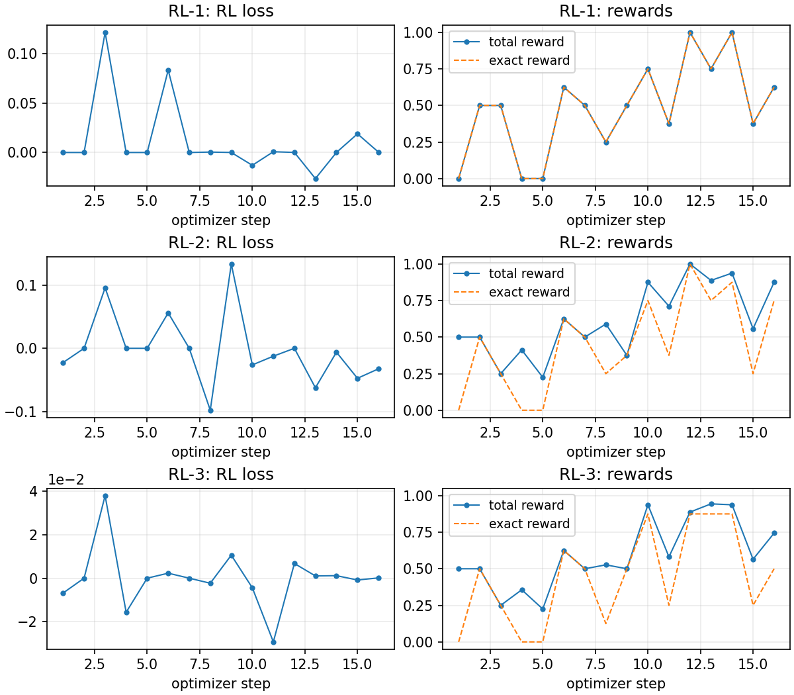

# ДЗ5. RL для вызова функций

В работе сравнивались исходная Qwen/Qwen3.5-2B и три RL-конфига. Обучение шло на физическом GPU 1, NVIDIA A100-SXM4 80 GB. Во всех экспериментах использовались ToolACE и TRL, обучались LoRA-веса. Перед BFCL адаптер объединялся с исходной моделью.

## Данные

В ToolACE было 11 300 диалогов, после удаления точных повторов осталось 11 297. Разделение примерно 95/5 сделано по хешу целого диалога до нарезки на префиксы. Общих диалогов у train и validation нет.

Реплика assistant после user превращалась в промпт с историей и эталон вызовов. Финальные пересказы после tool пропускались. Из system извлекались схемы инструментов, типы dict/float менялись на object/number, имена с пробелами получали алиасы. История переводилась в tool_calls и форматировалась исходным chat template с `enable_thinking=False`. Вызовы разбирались через AST без исполнения.

| До фильтрации | Медиана | p90 | Максимум |
|---|---:|---:|---:|
| Длина промпта, токены | 697 | 1200 | 4598 |
| Длина ответа, токены | 67 | 216 | 1239 |
| Инструментов на диалог | 3 | 6 | 9 |

Отброшены 766 диалогов с неразобранными tools. В 104 случаях встретился неразобранный вызов, после него диалог дальше не использовался. Еще 530 префиксов не прошли ограничения длины или проверку эталона. Максимум промпта составил 1536 токенов, эталона 384.

После фильтрации было доступно 10 531 train и 504 validation-префикса. Для короткого эксперимента оставлены 1536 train, из них 1152 с вызовом и 384 без вызова. В validation осталось 128 примеров, соотношение 96/32. Эталон передавался только функции награды.

Версия ToolACE закреплена на `6bda777c88d21e5a204703c1ee45597a8fa4f734`, модель на `15852e8c16360a2fea060d615a32b45270f8a8fc`. Seed и data_seed равны 42.

## Награда

Порядок вызовов не учитывается, повторы учитываются. Использованы четыре компоненты.

- **F** равна 1 при корректной разметке и успешном разборе ответа.
- **N** считается как F1 по именам функций.
- **A** считается как F1 по тройкам `(функция, аргумент, значение)`.
- **E** равна 1 при полном совпадении всех вызовов и аргументов с эталоном.

Для F1 используется `2 × |C ∩ C*| / (|C| + |C*|)`, пересечение учитывает повторы. Для двух пустых наборов F1 равна 1.

```text
R_exact = E
R_dense = 0.1 × F + 0.2 × N + 0.3 × A + 0.4 × E
```

Когда вызов не нужен, обе награды равны 1 за непустой ответ без вызовов. Качество уточняющего текста при этом не проверяется. Сломанная разметка и неизвестная функция дают 0.

Например, эталон `United_States_COVID_19_Case_Count(string="2026-06-05")` дает следующие результаты. Это проверочные ответы, построенные на эталоне ToolACE.

| Ответ | Exact | Dense |
|---|---:|---:|
| Правильный вызов | 1.00 | 1.00 |
| Тот же вызов со значением `2026-06-05__wrong` | 0.00 | 0.30 |
| Пропущен нужный вызов, ответ `Please clarify.` | 0.00 | 0.10 |
| Сломанная разметка вызова | 0.00 | 0.00 |
| `Please clarify.`, когда вызов не нужен | 1.00 | 1.00 |
| Лишний вызов | 0.00 | 0.00 |

Dense выбрана чтобы давать сигнал за частично правильный ответ. У бинарной награды все неудачные ответы одинаковые, поэтому внутри группы часто получается нулевой advantage. При этом dense тоже имеет недостаток, модель может получать часть баллов при неправильном действии.

## Обучение и конфиги

Использовано окружение из Dockerfile. Основные версии — torch 2.11.0+cu129, TRL 1.16.0, Transformers 5.9.0, PEFT 0.18.1 и vLLM 0.22.0.

Общие настройки всех трех запусков приведены ниже. Полные фактические конфиги сохранены в [configs.json](configs.json).

| Параметр | Значение |
|---|---|
| Шагов оптимизатора | 16 |
| Learning rate / scheduler | 1e-5 / constant_with_warmup |
| Warmup | 2 шага |
| Beta / epsilon | 0.01 / 0.2 |
| Batch / gradient accumulation | 2 / 4 |
| Генераций на запрос | 4 |
| Temperature / top_p | 0.8 / 0.95 |
| Максимум новых токенов | 512 |
| Точность | BF16 |
| LoRA r / alpha / dropout | 16 / 32 / 0 |
| Target modules | language-MLP gate_proj, up_proj, down_proj |
| Обучаемых параметров | 9 437 184 |

За один запуск обрабатывались примерно 32 разных запроса и 128 ответов. Бюджет маленький чтобы быстро сравнить настройки. Во всех случаях выбран последний шаг 16. Дополнительная ToolACE-валидация завершилась для RL-1 на 32 запросах. У RL-2 она остановлена после сохранения адаптера, у RL-3 пропущена. Для всех четырех моделей полностью выполнен BFCL.

| Запуск | Loss | Награда | Нормировка | Гипотеза |
|---|---|---|---|---|
| RL-1 (`rl1_exact`) | GRPO | exact | std по группе | Проверить простой бинарный сигнал |
| RL-2 (`rl2_dense`) | GRPO | dense | std по группе | Частичная награда уменьшит число групп с одинаковыми наградами |
| RL-3 (`rl3_drgrpo`) | Dr. GRPO | dense | без деления на std | Фиксированная нормировка по 512 токенам уменьшит смещение к коротким ответам |

В паре RL-1/RL-2 менялась только форма награды. В паре RL-2/RL-3 одновременно менялись две нормировки Dr. GRPO, поэтому отдельно их эффект тут не измерялся.

## Результаты BFCL

Оценка проведена исходным `evaluate.py` на всех 350 примерах. Параметры финальной генерации — temperature=0, максимум 1024 новых токена, seed=42, thinking выключен. Все числа в таблице указаны в процентах.

| Запуск | Overall | Simple | Multiple | Parallel | Parallel + Multiple | Irrelevance |
|---|---:|---:|---:|---:|---:|---:|
| Baseline | 68.93 | 68.00 | 78.67 | 56.00 | 80.00 | 62.00 |
| RL-1 | 65.33 | 62.00 | 74.67 | 52.00 | 60.00 | 78.00 |
| RL-2 | 66.53 | 64.00 | 74.67 | 54.00 | 68.00 | 72.00 |
| RL-3 | 68.27 | 64.00 | 75.33 | 54.00 | 70.00 | 78.00 |

Overall считается как среднее пяти групп. Multiple содержит 150 примеров, остальные группы по 50. Результаты и полные ответы лежат в `results/<run>/metrics.json` и `results/<run>/predictions.jsonl`.

Лучший обученный вариант RL-3 получил 68.27%, это на 0.67 п.п. ниже baseline. Улучшить исходную модель за этот короткий прогон не получилось. У RL-3 выросла Irrelevance, но качество вызовов в остальных группах снизилось.

Замена exact на dense дала +1.20 п.п., переход к Dr. GRPO еще +1.73 п.п. Среди этих двух изменений сильнее повлиял переход к Dr. GRPO. Все остальные настройки в сравниваемых парах одинаковые. Один seed и маленький бюджет ограничивают надежность такого вывода.

## Loss и награды



Кривые взяты из фактических логов обучения, без сглаживания. RL loss может быть отрицательным и близким к нулю. Качество проверялось отдельно на BFCL.

| Запуск | Reward первых 4 шагов | Reward последних 4 шагов | Доля групп с одинаковой наградой |
|---|---:|---:|---:|
| RL-1 | 0.250 | 0.688 | 68.8% |
| RL-2 | 0.416 | 0.814 | 56.2% |
| RL-3 | 0.402 | 0.797 | 43.8% |

У RL-2 средняя dense-награда выросла с 0.416 до 0.814, но итоговый BFCL остался ниже baseline. Dense дает баллы за правильное имя или часть аргументов, а BFCL требует полностью правильного действия. Кроме того, первые и последние шаги используют разные запросы. Поэтому рост reward здесь не доказывает рост качества. На графике показан и общий для всех конфигов exact reward.

Если все четыре ответа на запрос имеют одинаковую награду, `R_i - mean(R) = 0`, поэтому advantage равен нулю. Деление на `std + epsilon` сохраняет этот ноль. Сигнал от reward пропадает, KL-штраф при beta=0.01 может оставаться.

## Ошибки лучшего обученного варианта

Ниже реальные ошибки RL-3 из `results/rl3_drgrpo/predictions.jsonl`.

### Лишний вызов, irrelevance_233

Запрос пользователя — `What is the equivalent of $20 in British Pounds?`

Эталон предполагает отсутствие вызова. Модель вызвала `weather_in_location(location="London", unit="C")`. Этот инструмент отвечает за погоду и не решает запрос про валюту. Проверка вернула ошибку «Вызов инструмента не требовался».

### Пропущенный вызов, simple_241

Запрос пользователя — `Who was the U.S. president during the Civil War?`

Ожидался `US_President_During_Event(event="Civil War", country="USA")`. Модель ответила текстом про Авраама Линкольна и не вызвала инструмент. Нужное действие осталось невыполненным, проверка вернула «Ожидался вызов инструмента».

### Ошибка в аргументе, multiple_119

Запрос пользователя — `Find records in database in user table where age is greater than 25 and job is 'engineer'.`

Функция `database.query` выбрана правильно. В полученных вызовах условия были такими.

```json
[
  {"field": "age", "operation": ">", "value": 25},
  {"field": "job", "operation": "=", "value": "engineer"}
]
```

В эталоне значение возраста записано строкой `"25"`. Модель передала число `25`, поэтому официальный checker вернул `value_error:dict_value`. Ошибки в типе вложенного аргумента достаточно чтобы весь пример получил 0.

## Вывод

В коротком эксперименте Dr. GRPO с dense-наградой оказался лучшим среди обученных вариантов, но baseline сохранил более высокий overall. Частичная награда уменьшила долю групп без различий между ответами. При этом большая награда сама по себе не обеспечила улучшения BFCL.

Главное ограничение — всего 16 обновлений и один seed. По этим результатам можно сравнить три коротких прогона. Для более уверенного вывода потребуется больший бюджет обучения и повторные запуски.
