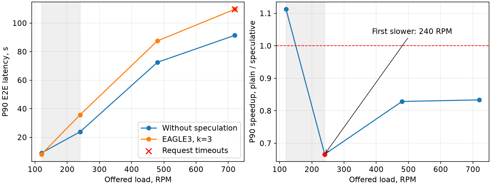
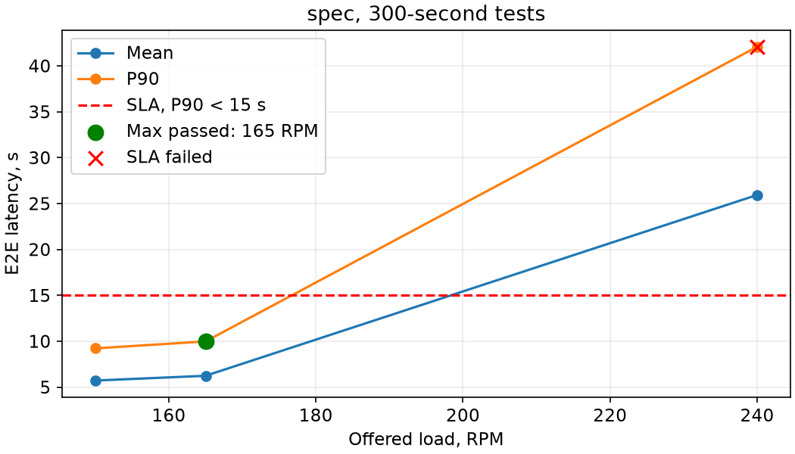

# ДЗ6. Инференс и нагрузочное тестирование

При 120 RPM удалось уменьшить среднюю задержку с **6,876 до 4,919 с**, ускорение составило **1,398×**. Лучшей стала конфигурация с EAGLE3. Ниже сравниваются настройки движка, поведение спекдека при росте нагрузки и результат 300-секундных тестов.

## Сетап и методика

Использовались одна NVIDIA A100-SXM4 80 GB, физический GPU 0, vLLM 0.22.0 и AIPerf 0.13.0 из предоставленного Dockerfile. Целевая модель во всех замерах — `Qwen/Qwen3-8B`. В запросах заданы temperature=0, seed=42, максимум 512 новых токенов и `enable_thinking=False`.

В `data/requests.jsonl` находятся 640 запросов. SHA256 файла — `67c48379e5ae2608f7ca08650fd346facdc01f766a3e8eecea6459d7cec00ebc`.

Для сравнения конфигураций и исследования спекдека каждый раз использовались все 640 запросов в последовательном порядке. Перед замером выполнялись 40 прогревочных запросов с параллельностью 8, они исключались из итоговой статистики. Prefix cache очищался через `/reset_prefix_cache` перед и после каждого прогона. Загрузка модели и компиляция графов происходили до замеров.

Нагрузка задавалась открытым потоком с постоянным интервалом между запросами. Основные метрики взяты из `request_latency` в JSON AIPerf и переведены из миллисекунд в секунды. Для нагрузочных тестов запросы отправлялись 300 секунд, затем ожидались оставшиеся ответы, как в исходном `load_test.sh`.

## 1. Подбор конфигурации при 120 RPM

Все варианты задаются через `CONFIG` в [serve.sh](serve.sh). Для baseline использовались стандартные настройки движка. Во всех вариантах дополнительно фиксировались seed и ревизия модели.

| Конфигурация | Параметры сверх baseline |
|---|---|
| `baseline` | Стандартный vLLM |
| `chunk2048` | `max_num_batched_tokens=2048` |
| `graphs` | Chunk 2048, `max_num_seqs=128`, размеры CUDA graphs 1–32, 48, 64, 96, 128 |
| `spec` | Настройки `graphs` и EAGLE3, 3 черновых токена |

Для спекдека использована `RedHatAI/Qwen3-8B-speculator.eagle3`. Она предлагает токены, а Qwen3-8B проверяет их. Ревизии обеих моделей закреплены в скрипте. Эта голова предназначена для Qwen3-8B с выключенным thinking. [Карточка EAGLE3](https://huggingface.co/RedHatAI/Qwen3-8B-speculator.eagle3)

Ускорение считалось как `S = Mean Latency baseline / Mean Latency конфигурации`.

| Конфигурация | Mean Latency, с | P90, с | S |
|---|---:|---:|---:|
| baseline | 6,876 | 9,752 | 1,000 |
| chunk2048 | 6,869 | 9,693 | 1,001 |
| graphs | 6,592 | 8,968 | 1,043 |
| spec | 4,919 | 8,063 | 1,398 |

Каждый прогон завершился на 640 запросах без ошибок. Средняя длина ответа была близкой — 419,7 токена у baseline и 420,6 у spec.

Уменьшение chunk почти не помогло. TTFT у baseline и chunk2048 составил примерно 119 мс, а inter-token latency около 16 мс. Здесь основное время уходило на генерацию ответа, поэтому изменение обработки префилла дало мало. У chunked prefill есть компромисс между задержкой очередного токена и временем до первого токена. [Документация vLLM](https://docs.vllm.ai/en/v0.22.0/configuration/optimization/)

Сочетание более плотных CUDA graphs и лимита 128 последовательностей дало около 4,3% по средней задержке. Эти две настройки менялись вместе, отдельно их вклад не измерялся. У spec inter-token latency снизилась до 11,37 мс, при этом TTFT немного вырос до 131 мс.

По счетчикам сервера за прогрев и первый полный прогон spec было принято 138 775 из 441 003 черновых токенов, то есть 31,5%. Принимать удалось достаточно токенов чтобы сократить число шагов целевой модели. Но доля принятых предложений ограничивает возможное ускорение.

Каждая конфигурация измерялась один раз. Разница в 0,1% у chunk2048 слишком маленькая чтобы уверенно считать ее улучшением.

## 2. Как нагрузка влияет на спекдек

Сравнивались `graphs` и `spec`, у них совпадали настройки chunked prefill и CUDA graphs. Здесь ускорение считалось по P90 как `P90 без spec / P90 со spec`.

| Нагрузка, RPM | P90 без spec, с | P90 EAGLE3, с | Ускорение по P90 | Ошибок без spec / со spec |
|---|---:|---:|---:|---:|
| 120 | 8,968 | 8,063 | 1,112 | 0 / 0 |
| 240 | 23,803 | 35,744 | 0,666 | 0 / 0 |
| 480 | 72,485 | 87,487 | 0,829 | 0 / 0 |
| 720 | 91,355 | 109,629 | 0,833 | 0 / 3 |

При 120 RPM спекдек выигрывает. На 240 RPM он уже хуже, это первая проигравшая точка на проверенной сетке. Граница смены эффекта находится между 120 и 240 RPM, этот диапазон выделен серым. Внутри него дополнительные точки не измерялись.

На небольшой нагрузке GPU может экономить время за счет нескольких принятых токенов за шаг. Когда запросов много, проверка предложений и работа черновой головы добавляют вычисления. В этих замерах это перевесило выигрыш от принятых токенов. Поэтому лучший вариант на 120 RPM не обязательно дает лучший результат на большой нагрузке.

На 720 RPM у spec три запроса завершились по таймауту 120 с, успешных ответов осталось 637 из 640. В таблице и на графике приведен P90 из AIPerf, точка с таймаутами отмечена красным крестиком.

## 3. Нагрузочное тестирование и SLA

Проверялась конфигурация `spec`, выбранная по средней задержке на 120 RPM. Использовался `load_test.sh`, на каждом уровне поток запросов поддерживался 300 секунд. В этой части набор из 640 запросов повторяется по кругу. Условие прохождения — P90 E2E Latency строго меньше 15 с, также проверялось отсутствие ошибок запросов.

| Нагрузка, RPM | Время подачи нагрузки, с | Успешных запросов | Ошибок | Mean, с | P90, с | SLA |
|---|---:|---:|---:|---:|---:|---|
| 150 | 300 | 750 | 0 | 5,710 | 9,215 | Пройден |
| 165 | 300 | 825 | 0 | 6,230 | 9,974 | Пройден |
| 240 | 300 | 1199 | 0 | 25,929 | 42,071 | Нарушен |

Максимальная подтвержденная нагрузка на проверенной сетке — **165 RPM, или 2,75 RPS**. При ней P90 составил 9,974 с. На 240 RPM P90 вырос до 42,071 с и SLA нарушился. Все запросы в этих трех тестах завершились успешно.

Порог SLA локализован между 165 и 240 RPM. Это ограничение точности выбранной сетки, 165 RPM является максимальной проверенной прошедшей точкой. На графике она отмечена зеленым, перегрузка отмечена красным крестиком.

При росте потока запросы начинают дольше ждать обработки. Поэтому отсутствие ошибок еще не означает выполнение SLA. Для этой конфигурации это видно на 240 RPM, где ответы приходят, но P90 сильно выше 15 с.

Итоговые метрики сохранены в `results/metrics.csv`. Исходные экспорты AIPerf вместе с версиями и хешами собраны в `results/measurements.json`. Команды повторного запуска находятся в [README.md](README.md).
